# ShopSight - Customer Behavior Data Analyst Portfolio Project
This project represents a complete, industry standard, end-to-end data analytics workflow, designed to mirror the real responsibilities of professional analysts in modern business environments. The project encompasses all critical stages of data analysis, from data preparation and modeling to insight generation, visualization, and reporting.

# About This Project

This project analyzes customer shopping behavior using transactional data from **3,900 purchases** across various product categories. The goal is to uncover insights into spending patterns, customer segments, product preferences, and subscription behavior to guide strategic business decisions.

The dataset contains **3,900 rows and 18 columns**. Its key features include:

- **Customer demographics:** Age, Gender, Location, and Subscription Status.
- **Purchase details:** Item Purchased, Category, Purchase Amount, Season, Size, and Color.
- **Shopping behavior:** Discount Applied, Promo Code Used, Previous Purchases, Frequency of Purchases, Review Rating, and Shipping Type.
- **Missing data:** 37 values in the Review Rating column.

We began with data preparation and cleaning in Python:

- **Data Loading:** Imported the dataset using `pandas`.
- **Initial Exploration:** Used `df.info()` to check the structure and `.describe()` for summary statistics.

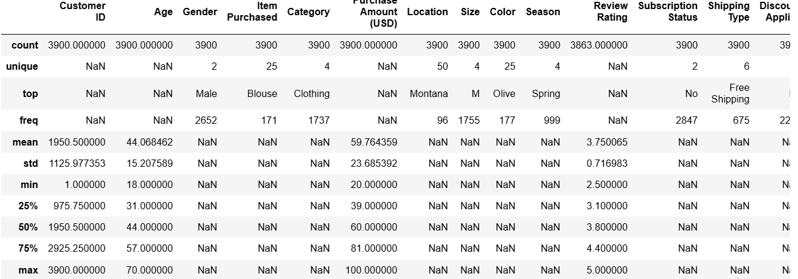

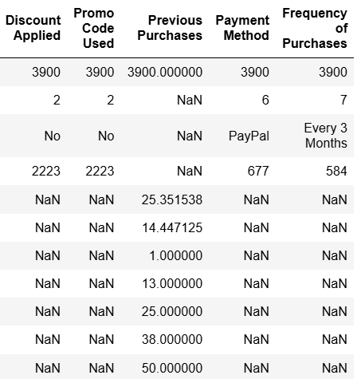

- **Missing Data Handling:** Checked for null values and imputed missing values in the Review Rating column using the median rating of each product category.
- **Column Standardization:** Renamed columns to snake case for better readability and documentation.
- **Feature Engineering:** Created an `age_group` column by binning customer ages and a `purchase_frequency_days` column from purchase data.
- **Data Consistency Check:** Verified if `discount_applied` and `promo_code_used` were redundant; dropped `promo_code_used`.
- **Database Integration:** Connected the Python script to PostgreSQL and loaded the cleaned DataFrame into the database for SQL analysis.

We performed structured analysis in PostgreSQL to answer key business questions:

1. **Revenue by Gender:** Compared total revenue generated by male vs. female customers.

   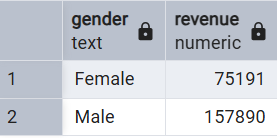

2. **High-Spending Discount Users:** Identified customers who used discounts but still spent above the average purchase amount.

   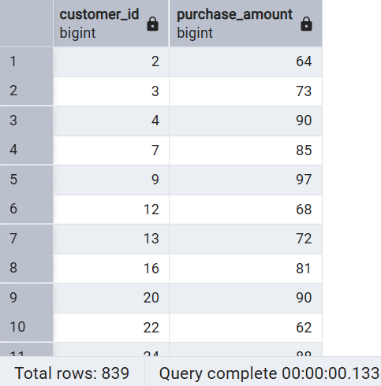

3. **Top 5 Products by Rating:** Found products with the highest average review ratings.

   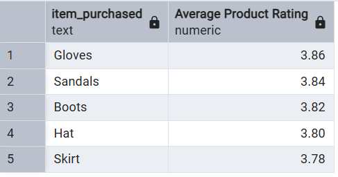

4. **Shipping Type Comparison:** Compared average purchase amounts between Standard and Express shipping.

   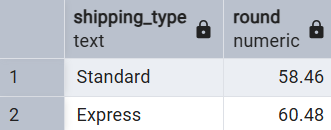

5. **Subscribers vs. Non-Subscribers:** Compared average spend and total revenue across subscription status.

   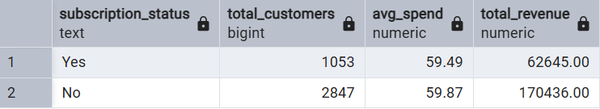

6. **Discount-Dependent Products:** Identified 5 products with the highest percentage of discounted purchases.

   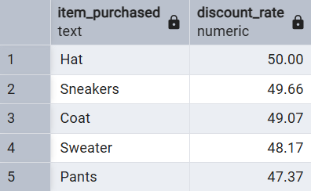

7. **Customer Segmentation:** Classified customers into New, Returning, and Loyal segments based on purchase history.

   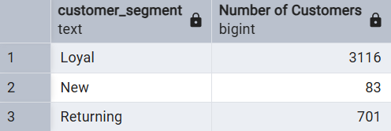

8. **Top 3 Products per Category:** Listed the most purchased products within each category.

   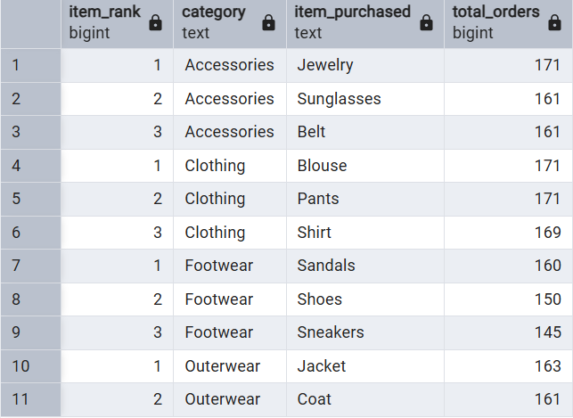

9. **Repeat Buyers & Subscriptions:** Checked whether customers with more than 5 purchases are more likely to subscribe.

   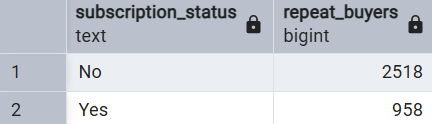

10. **Revenue by Age Group:** Calculated total revenue contribution of each age group.

   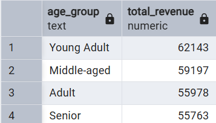

Finally, we built an interactive dashboard in **Power BI** to present insights visually.

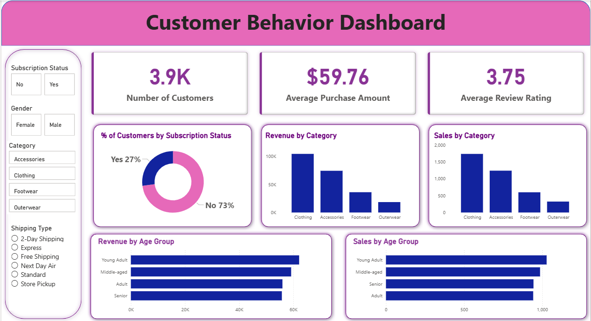

Based on the analysis, the following business recommendations were identified:

- **Boost Subscriptions:** Promote exclusive benefits for subscribers.
- **Customer Loyalty Programs:** Reward repeat buyers to move them into the “Loyal” segment.
- **Review Discount Policy:** Balance sales boosts with margin control.
- **Product Positioning:** Highlight top-rated and best-selling products in campaigns.
- **Targeted Marketing:** Focus efforts on high-revenue age groups and express-shipping users.
